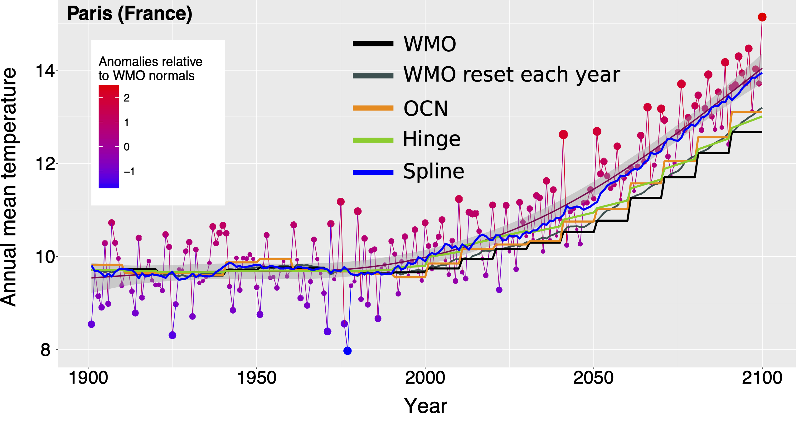

# Alix Rigal — Mathématiques appliquées, statistique et R&D

> **Portfolio scientifique · Modélisation statistique · Données environnementales et industrielles**

Docteur en mathématiques appliquées, spécialisé en modélisation statistique, je conçois et mets en œuvre des approches quantitatives pour analyser des données complexes, caractériser les incertitudes et répondre à des problématiques scientifiques ou industrielles.

Mon parcours associe recherche académique, projets de R&D, conseil statistique et enseignement supérieur.

<!-- Commentaire interne : ajouter ici le lien vers la publication vérifiée. -->
### Ressources et contact:

* **Portfolio en ligne (en cours d'édition) :** [https://galaxilir.github.io/Portfolio/]
* **CV :** [Consulter ici (PDF)](assets/CV__Spontane_IR.pdf)
* **portefeuille de compétences:**[Consulter ici (PDF)](assets/portefeuille2competences.pdf)
* **Contact :** [alix.rigal@transverselab.com]

---

## Vue d’ensemble Profil scientifique

* **Positionnement :** ingénierie R&D en modélisation statistique appliquée, avec une spécialisation dans les données environnementales ou industrielles.
* **Recherche :** doctorat en mathématiques appliquées et publication dans *Climate Dynamics*.
* **R&D et conseil :** cofondateur de TransverseLab ; missions portant notamment sur l’incertitude, les plans d’expérience et la reconstruction de séries temporelles.
* **Enseignement :** plus de 250 heures d’enseignement en mathématiques appliquées, probabilités, statistique et analyse de données.
* **Outils principaux :** R, Python, Matlab, Bash, LaTeX et outils de traitement de données scientifiques.
* **Imagerie scientifique récente :** traitement d’images 3D avec Fiji/ImageJ, macros ImageJ au format `.ijm`, mesures géométriques de volumes multiphasés et utilisation de méthodes d’apprentissage automatique avec Python.

## Parcours professionnel et scientifique

### TransverseLab — Cofondateur et statisticien

*2022 – aujourd’hui*

* Modélisation statistique avancée et développement de pipelines reproductibles en R, Python et Matlab.
* Projets portant notamment sur les plans d’expérience, la quantification d’incertitude, l’analyse de protocoles et la reconstruction de séries temporelles environnementales.
* Contribution au pilotage scientifique et technique, aux échanges avec les clients et à la gestion de projets.
* Participation à la prospection, aux propositions commerciales et au suivi administratif des missions.

### Postdoctorat — LISST

*2021 – 2022*

* Étude de l’impact de la crise sanitaire sur la mobilité urbaine à partir de données de vélos en libre-service.
* Analyse d’un jeu de données couvrant environ 700 stations, à une résolution temporelle de la minute sur deux ans.
* Utilisation de méthodes de séries temporelles, de modèles additifs généralisés (GAM) et d’analyse factorielle.

### Doctorat en mathématiques appliquées — CNRM / Université de Toulouse

*2016 – 2020*

* Étude de la déformation du cycle saisonnier dans un climat non stationnaire.
* Développement de méthodes de modélisation non paramétrique, notamment à base de splines et de méthodes de lissage.
* Travaux sur l’estimation de normales climatologiques quotidiennes dans un climat changeant.
<!-- 

[(images/NormAnParistemp1.pdf)

*Figure — Estimation de normales climatologiques. Cliquer sur l’image pour ouvrir le PDF complet.*
### Enseignement supérieur — ENAC et École nationale de la météorologie

* Plus de 250 heures d’enseignement.
* Probabilités, statistique, estimation et tests.
* Variables climatiques, statistique saisonnière et analyse de données météorologiques avec R.
* Analyse en composantes principales (ACP) et méthodes de classification.

## Compétences

### Modélisation statistique

* Modèles additifs généralisés (GAM) et régressions quantiles.
* Splines de lissage, méthodes à noyaux et méthodes non paramétriques.
* Séries temporelles et analyse factorielle.
* Bootstrap, validation croisée, sélection de modèles et estimation d’hyperparamètres.
* Géostatistique et krigeage.
* Quantification d’incertitude et plans d’expérience.
* Estimation statistique, tests d’hypothèses et inférence.

### Données environnementales et industrielles

* Analyse de données climatiques et météorologiques.
* Données spatio-temporelles, pollution et mobilité.
* Reconstruction de séries temporelles à partir de variables explicatives.
* Analyse et interprétation de données expérimentales.
* Étude de protocoles et comparaison de stratégies de mesure.

### Programmation scientifique et reproductibilité

* **R :** expertise en analyse statistique et développement de scripts.
* **Python, Matlab, Scilab :** analyse et traitement de données.
* **Bash, LaTeX, CDO :** outils de calcul scientifique, rédaction et traitement de données.
* **R Markdown et Jupyter :** supports et analyses reproductibles, selon les projets.
* **Git et GitHub :** gestion de versions et publication de projets scientifiques.

### Imagerie scientifique 3D

Travail récent sur des données d’images 3D représentant plusieurs phases : solide, huile, eau et air.

* Traitement d’images avec **Fiji/ImageJ**.
* Développement de macros ImageJ au format `.ijm`.
* Mesure de propriétés géométriques et de volumes à partir d’images 3D.
* Utilisation de **Python** et exploration de méthodes d’apprentissage automatique, notamment les forêts aléatoires et SAM 2.

La fiche projet associée précisera les étapes de traitement, le rôle de chaque méthode, les critères de validation et les résultats effectivement obtenus.

### Apprentissage automatique

* Connaissances théoriques sur les réseaux de neurones convolutifs et récurrents, les LSTM, les autoencodeurs, les GAN et les Transformers.
* Travaux personnels reproductibles en développement.

## Projets scientifiques et R&D

### 1. Estimation de normales climatologiques dans un climat changeant

**Problématique :** estimer des normales climatologiques quotidiennes lorsque le climat évolue et que l’hypothèse de stationnarité doit être remise en question.

**Approches :**

* Modélisation non paramétrique.
* Méthodes de lissage et splines.
* Analyse statistique de données climatiques.

**Publication associée :** *Climate Dynamics* (2018), « Estimating daily climatological normals in a changing climate ».

### 2. Analyse de la mobilité urbaine

**Problématique :** caractériser les évolutions de la mobilité à partir de données de vélos en libre-service.

**Données :** environ 700 stations, avec une résolution temporelle de la minute sur deux ans.

**Méthodes :**

* Analyse de séries temporelles.
* Modèles additifs généralisés (GAM).
* Analyse factorielle.

**Publication associée :** travail diffusé sur arXiv en 2021. Le titre exact et le lien seront ajoutés après vérification.

### 3. Plans d’expérience et quantification d’incertitude

Missions de R&D appliquée portant notamment sur la comparaison de protocoles, l’analyse de données expérimentales et la caractérisation de l’incertitude.

Les fiches détaillées des projets préciseront, pour chaque cas, la question scientifique, les données utilisées, la méthodologie, les résultats communicables et les limites.

### 4. Reconstruction de séries temporelles environnementales

Travail de modélisation visant à reconstruire des séries temporelles de paramètres chimiques à partir de variables explicatives, dans le cadre d’une mission appliquée pour un acteur de l’environnement.

La fiche projet précisera les variables étudiées, la méthode de validation, les métriques disponibles et les résultats publiables.

### 5. Traitement d’images 3D multiphasées

**Objectif :** extraire des mesures géométriques et des volumes à partir de données d’images 3D représentant plusieurs phases : solide, huile, eau et air.

**Outils et méthodes utilisés ou mobilisés :**

* Fiji/ImageJ et macros `.ijm`.
* Python.
* Forêts aléatoires.
* SAM 2.

Ce travail sera documenté plus en détail pour distinguer les étapes de prétraitement, de segmentation ou classification, de mesure et de validation. Les résultats chiffrés seront publiés uniquement lorsqu’ils auront été vérifiés et pourront être diffusés.

## Publications

* **2018 — *Climate Dynamics*.** « Estimating daily climatological normals in a changing climate ».
* **2021 — arXiv.** Travail sur les données de vélos en libre-service et la mobilité urbaine. Le titre exact et le lien seront ajoutés après vérification.

## Enseignement et communication scientifique

* Plus de 250 heures d’enseignement en mathématiques appliquées, probabilités, statistique et analyse de données.
* Présentations scientifiques et participation à des collectifs scientifiques, notamment BiblioStat et Géo-Maître.
* Français : langue maternelle.
* Anglais : courant.

## Philosophie de travail

Ma démarche consiste à traduire une question scientifique ou industrielle en une approche quantitative explicite :

1. Comprendre le contexte et les objectifs.
2. Examiner la qualité, la structure et les limites des données.
3. Choisir une méthode statistique adaptée à la question.
4. Valider les résultats et caractériser les incertitudes.
5. Documenter le raisonnement, le code et les limites.
6. Communiquer les conclusions de manière claire et reproductible.

L’objectif n’est pas seulement de produire un modèle, mais de comprendre ce qu’il permet de conclure, dans quelles conditions et avec quelles limites.

## À propos de ce dépôt

Ce dépôt présente une vitrine scientifique et professionnelle : projets sélectionnés, méthodes, publications et démonstrations reproductibles.

Les données confidentielles, les données brutes non publiques, les documents clients et les travaux internes ne doivent pas être publiés ici. Les illustrations génériques seront clairement identifiées comme telles et ne seront pas présentées comme des résultats expérimentaux.

## Navigation

* **Portfolio en ligne :** [URL GitHub Pages à compléter]
* **Code et démonstrations :** parcourir les dossiers de ce dépôt.
* **CV détaillé :** [chemin du PDF à compléter après ajout du fichier]
* **Contact :** [adresse professionnelle à compléter]

## Pour les recruteurs

Je suis particulièrement intéressé par des missions d’ingénierie R&D et de recherche appliquée nécessitant de transformer une question scientifique ou industrielle en démarche statistique rigoureuse : compréhension des données, choix du modèle, validation, analyse de l’incertitude et restitution des résultats.

Mon parcours associe une formation approfondie en mathématiques appliquées, une expérience de recherche académique, des projets R&D et une activité d’enseignement supérieur.

